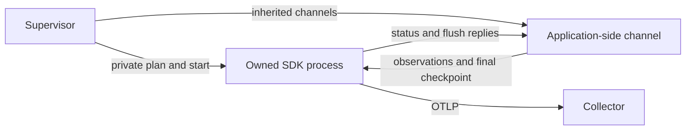

# Python SDK process bridge

<!-- markdownlint-disable MD013 -->

This is an internal SDK/adapter building block. The source-free Python launcher, CPython monitoring, application context integration and lifetime observers are still pending. Python remains in the public plan's `remaining` list. Component fixtures use explicit bridge calls; they are not the developer example applications.

## Process ownership

The command-line supervisor starts `SdkProcess` from otelc's SDK environment. The worker uses that interpreter with `-I -B`, its exact script, a private inherited plan and inherited pipes. SDK diagnostics go to `python-sdk.log`; its stdout is separate from application stdout. The supervisor can pass only the channel descriptors and launch identity into the application, then close its own descriptor copies.



Initial readiness means the SDK worker is waiting for an application. The first `hello` binds its native PID and launch ID; SDK resource `process.pid` uses that application PID. The worker's own PID is reported separately as `sdk_pid`. Replies and the final report bind both identities, the launch ID and the SHA-256 of the complete canonical resolved common policy. The supervisor checks actual worker exit as well as the report.

A final checkpoint followed by actual pipe EOF closes the observation stream. The SDK then drains outside application execution. The tests prove a native fixture can return its original output while an actual metric request is still waiting for acknowledgement; body receipt alone is not an SDK acknowledgement. A missing checkpoint, invalid record, mismatched counts or unfinished calls cannot become a clean run. Existing runtime directories and metadata are preserved by exclusive creation.

## SDK behaviour

The worker reuses the official Python metric provider, aggregation, resources, `ReadableSpan`, batch span processor, protobuf exporters and HTTP retry handling. The [metric gates](python-sdk-controls.md) implement collection/emission control. Histogram boundaries for function and lifetime durations come from the common policy. Completed sampled spans retain source IDs, parents, links, events, scope, status and dropped-item counts; sampling belongs to the application-side tracer. The worker refuses span records when the common policy disables tracing.

Event and link records accept an optional unsigned 32-bit `dropped_attributes` count, defaulting to zero. Reconstruction preserves this source count through actual OTLP encoding, separately from span-level attribute, event and link drops. Frontends must send the observed count with surviving attributes; absence of this field cannot recover a count discarded by a frontend.

The stock periodic metric reader absorbs failed export results and its public `collect` method is final. `AccountedMetricReader` uses the SDK's public `MetricReader` base and declared receive extension point, with a small owned scheduler. It retains collection failures and exporter outcomes, including periodic failures, timeouts and recovery. It does not reimplement metric aggregation, protobuf encoding or transport retries. Repeated reader/exporter shutdown calls retain the original completion or failure.

Collection and emission changes travel in the same ordered stream as observations. Concurrent control requests retain their own status acknowledgement. Emission-off admits no new metric export; an admitted request remains pending until its actual outcome arrives. The effective-off flag stays false during that interval. Traces remain independent. A timed-out old reply cannot satisfy or poison a newer request.

SDK flush work runs separately from input processing and has a bounded reply wait. A stuck request stays visible in status; a later control can still disable new emission. Shutdown bounds the owner's wait. If underlying SDK work has not finished, its final evidence retains pending/unknown state and reports failure. This does not make a synchronous SDK operation cancellable.

## Handoff and evidence

Each JSON record contains primitive telemetry data. The channel never pickles application objects. Fourteen-byte chunk headers carry a magic value, monotonic record ID, part index/count and payload length. Each whole chunk is at most 512 bytes, within POSIX's minimum atomic pipe-write size. Payloads have a 16 MiB record limit and a 50 ms write-wait budget; serialization and host scheduling are separate costs.

A record is accepted by the writer only after all chunks enter the pipe. That is a handoff acknowledgement, not SDK processing or downstream receipt. A partially written record is loss; the next record can recover at its own boundary. EOF counts an incomplete record once. Producer and reader loss counts describe different layers and can refer to the same lost observation.

A thread-local signal guard converts the SDK pipe's own broken-write `SIGPIPE` into a loss even when an application uses the default or a custom handler. It restores the previous signal mask, preserves a previously pending signal and leaves the process handler unchanged. The native default-handler reproducer terminated with signal 13 before this guard; default/custom/blocked/pending-signal regressions now pass.

The record kinds are closed:

| Kind | Purpose |
| --- | --- |
| `hello` | Bind the actual application PID and launch identity before SDK use. |
| `metric` | Register/reuse an SDK counter, up/down counter, histogram or gauge and record a primitive value/context. |
| `span` | Hand off an already completed sampled span. |
| `controls` | Change both metric switches atomically. |
| `request` | Request status or a checked flush. |
| `checkpoint` | Seal source counts and the exact preceding handoff count before EOF. |

`SdkChannel.seal` takes the handoff snapshot and closes atomically with respect to other writers. Identity fields come from the channel; supplied producer facts cannot overwrite them. The SDK checks accepted/attempted/lost counts, span observations and application identity against the actual consumed stream. Open lifetimes become censored at EOF, with no invented GC or release timestamp.

The final `python-sdk-status.json` has `kind = "otelc.python.sdk"` and schema 1. `phase` is the overall result; `sdk_phase` records the SDK lifecycle separately. Queue pending/drop counts remain unavailable until a supported idle SDK shutdown establishes them. Raw exporter success, SDK queue accounting and source evidence do not prove downstream receipt or OTLP partial-rejection absence; both receipt fields remain explicitly unavailable. Independent consumers must decode the actual receiver data.

## Validation and limits

This POSIX component is currently tested locally on CPython 3.12 with the pinned SDK. Required Linux/macOS CI, independent review and final integrated qualification remain delivery gates. The primitive attribute profile covers scalars and homogeneous arrays, up to 128 attributes/events/links; opaque, nested and byte-valued attributes require further work. SDK instrument registration is bounded at 4096. Frontends must separately bound selected identities and metric attribute cardinality; a record-size bound is not a total-memory or peak-RSS guarantee.

Run the focused component checks from a prepared checkout:

```sh
PYTHONPATH=tests .venv/bin/python -m coverage run --branch --source=otelc.python_handoff,otelc.python_sdk_process,otelc.python_sdk_io,otelc.python_sdk_child,otelc.python_sdk_protocol,otelc.python_sdk_pipeline,otelc.python_sdk_reader -m unittest test_python_handoff test_python_sdk_channel test_python_sdk_protocol test_python_sdk_pipeline test_python_sdk_process test_python_sdk_io test_python_sdk_worker -v
.venv/bin/python -m coverage report --fail-under=80
make check
```

Tests include real pipe backpressure/recovery and reader death, native signal state, callback/SDK outcome accounting, exact decoded metadata, four same-worker live states, fixture RNG/output preservation, concurrent/late RPC replies, actual application exit before acknowledgement, incomplete/censored observations and a stuck export with bounded failed shutdown. These prove this process boundary, not an unchanged arbitrary application, a complete source closure or Python language admission.
